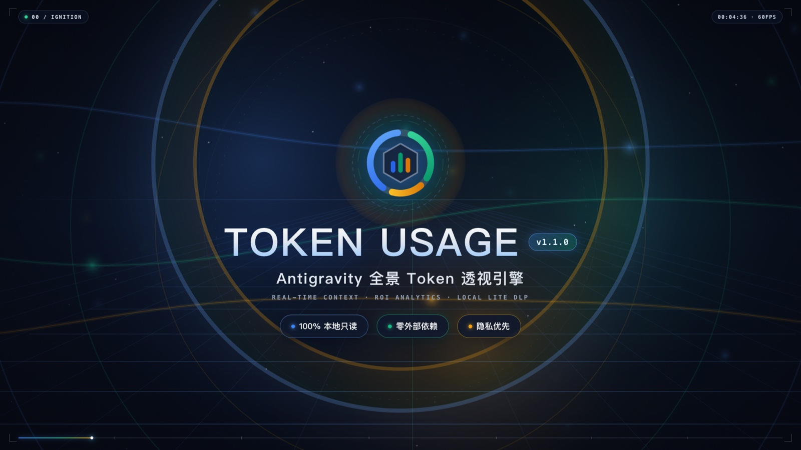
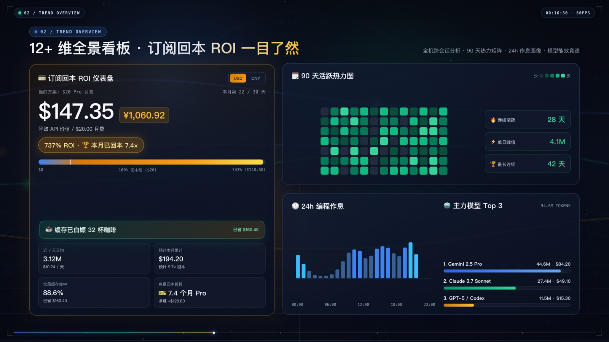
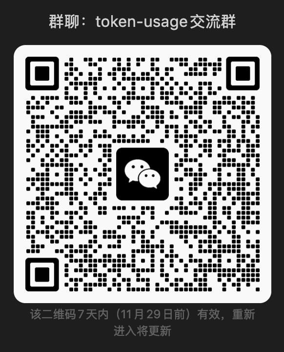

<p align="center">
  
</p>

<h1 align="center">Token Usage</h1>

<p align="center">
  <strong>Deja de quemar tokens a ciegas — Medidor de contexto en vivo, ROI de suscripción, diagnóstico y Lite DLP local para <a href="https://antigravity.google">Antigravity</a>.</strong><br />
  <sub>100% Local y Solo Lectura · Cero Dependencias · Privacidad Primero · Listo para Usar</sub>
</p>

<p align="center">
  <a href="./README.md">简体中文</a> ·
  <a href="./README.en.md">English</a> ·
  <a href="./README.ja.md">日本語</a> ·
  <a href="./README.ko.md">한국어</a> ·
  <strong>Español</strong>
</p>

<p align="center">
  <a href="./plugin.json"></a>
  <a href="./LICENSE"></a>
  <a href="./sidecars/token_panel/package.json"></a>
  <a href="#-privacidad-y-seguridad"></a>
  
</p>

<p align="center">
  
</p>

### 🎬 Demo en Video (48 segundos)

https://github.com/user-attachments/assets/a50520b6-e04e-488b-94e4-507da9354e38

---

## 🎯 ¿Por qué usar Token Usage?

| Problema Diario | Cómo lo Resuelve Token Usage |
| :--- | :--- |
| 😵 **El contexto se llena de golpe / amnesia tras Compact** | Medidor en tiempo real (usado / restante / límite), curva con puntos **Compact** marcados y alertas al `80% / 90%` |
| 💸 **¿Realmente estás amortizando tu suscripción?** | **Panel ROI de Suscripción** (`$20 Pro / $100 Ultra / $200 Ultra` o tarifa personalizada) con multiplicador ROI y ahorro de caché |
| 🐌 **Un turno tarda 20s: ¿es el modelo o una herramienta?** | División por turno de **pensamiento del modelo vs. ejecución de herramientas** + **Visor JSON en Árbol** integrado |
| 🔐 **Miedo a filtrar claves API o secretos en los logs** | **Lite DLP 100% Local** escanea 7 tipos de credenciales en memoria — nunca guarda valores reales y salta al turno con un clic |
| 📊 **Necesitas facturación por proyecto o tarjetas compartibles** | **Top 10 de Workspaces** automático, exportación CSV/JSON y **tarjetas PNG 2× Retina anonimizadas** |

---

## ⚡ Instalación en 10 Segundos (Recomendado: Una Frase al Agente)

Sin abrir la terminal. **Solo pega esta frase en el chat de Antigravity** y deja que el Agente instale, verifique y te entregue el enlace para activarlo:

> ```text
> Instala el plugin de Antigravity desde https://github.com/RanFeng/token-usage en ~/.gemini/config/plugins/token-usage (ejecuta sync.sh si está disponible), verifica los archivos instalados y dame el enlace para habilitar y abrir el panel de Token Usage.
> ```

> **🔄 Actualizar en una frase**:
> `Actualiza mi plugin token-usage desde https://github.com/RanFeng/token-usage a la última versión y sincronízalo en ~/.gemini/config/plugins/token-usage.`

<details>
<summary><strong>🛠️ ¿Prefieres instalación manual (CLI)? Haz clic para expandir</strong></summary>

- **Requisitos**: Antigravity / Node.js 18+ / Python 3.8+
- **macOS / Linux**:
  ```bash
  git clone https://github.com/RanFeng/token-usage.git
  cd token-usage && ./sync.sh
  ```
- **Windows (PowerShell)**:
  ```powershell
  git clone https://github.com/RanFeng/token-usage.git "$env:USERPROFILE\.gemini\config\plugins\token-usage"
  ```
- **Activar**: Antigravity → **Customizations / Plugins** → activa **Token Usage** → abre **Token Usage** en la barra auxiliar (**Aux Pane**).

</details>

---

## ✨ Recorrido Visual de Funciones

### 1. Telemetría de Contexto en Vivo y Desglose por Turno (Current)
<p align="center">
  
</p>

Medidor de ventana de contexto, acumulados `input / cache_read / output`, costo equivalente de API, detección automática de **Compact**, tiempos de pensamiento vs. herramientas y Visor JSON en Árbol.

### 2. Más de 12 Analíticas Globales y Panel ROI (Overview)
<p align="center">
  
</p>

Multiplicador ROI y proyección de fin de mes, mapa de calor de 90 días, gráfico diario de 14 días, perfil horario de 24h, Top 10 modelos y herramientas, logros locales y tarifas/monedas personalizadas (`USD`/`CNY`).

### 3. Diagnóstico en Tiempo Real y Lite DLP 100% Local
<p align="center">
  
</p>

4 alertas automáticas (cerca de Compact, bucles de error, picos de tokens, baja caché) y escáner local de 7 tipos de secretos (API Keys, AWS, GitHub, Google, JWT, claves privadas, DB URIs) con enmascaramiento total.

### 4. Radar Multi-Herramienta y Facturación por Proyecto
<p align="center">
  
</p>

Atribución automática de tus Top 10 workspaces, exportación en **CSV** (UTF-8 BOM), **JSON** y Markdown directo a `~/Downloads`, más radar de solo lectura para Claude Code, Codex, Cursor y Gemini CLI.

### 5. Tarjetas 2× Retina y Skill `/token-usage` en el Chat
<p align="center">
  
</p>

Tarjetas PNG 2× HiDPI en tema Oscuro/Claro, tarjetas de diagnóstico 100% anonimizadas (sin prompts, rutas ni secretos), además del Skill `/token-usage` en chat y script CLI (`token_stats.py`).

---

## 📖 Script CLI Independiente (`token_stats.py`)

```bash
# Resumen de sesiones recientes (--sort: recent | tokens)
python3 ~/.gemini/config/plugins/token-usage/skills/token-usage/scripts/token_stats.py summary --limit 15 --sort recent
# Desglose por turno (latest / prefijo de 8 caracteres / UUID completo)
python3 ~/.gemini/config/plugins/token-usage/skills/token-usage/scripts/token_stats.py session latest
# Totales globales y por modelo
python3 ~/.gemini/config/plugins/token-usage/skills/token-usage/scripts/token_stats.py models
```

---

## 🔒 Privacidad y Seguridad

- **100% Local y Solo Lectura**: Lee directamente `~/.gemini/antigravity/brain/`. Nunca sube conversaciones ni modifica binarios.
- **Cero Dependencias Externas**: Node.js ESM nativo + HTML/CSS/JS estándar + biblioteca estándar de Python 3.
- **Cero Telemetría**: La comprobación opcional de actualizaciones solo consulta la API pública de GitHub Releases (caché local de 7 días).

---

## 🌟 Comunidad y Enlaces

Si **Token Usage** te ahorra tiempo o tokens, ¡regálanos una **Star ⭐**!

- 💬 **Preguntas, Comparte tu ROI y Hoja de Ruta**: [GitHub Discussions](https://github.com/RanFeng/token-usage/discussions)
- 🐛 **Reportar Bugs o Sugerir Funciones**: [GitHub Issues](https://github.com/RanFeng/token-usage/issues)
- 📖 **Documentación**: [`.ai_map.md`](./.ai_map.md) · [CHANGELOG](./CHANGELOG.md) · [CONTRIBUTING](./CONTRIBUTING.md) · [MIT License](./LICENSE)

### 💬 Grupo de WeChat y Contacto

Escanea el código QR para unirte al **grupo de WeChat de token-usage** (si el código expira, agrega al autor en WeChat):

- **WeChat del Autor**: `x64Crack` (**por favor incluye la nota `token-usage` al contactar**)

<p align="center">
  
</p>
