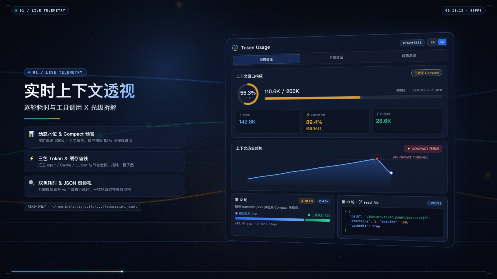
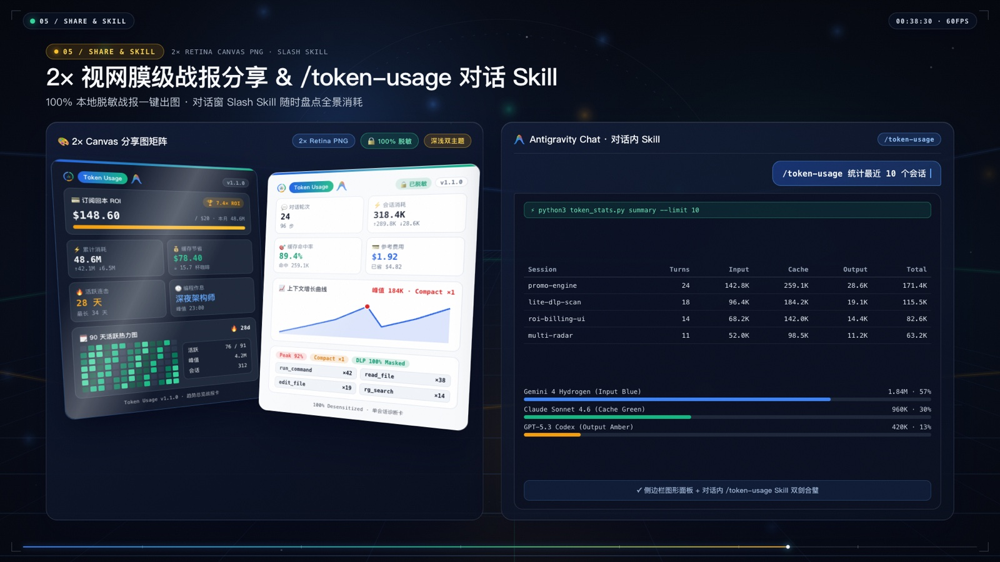

<p align="center">
  
</p>

<h1 align="center">Token Usage</h1>

<p align="center">
  <strong>もうトークン消費で“手探り”しない — <a href="https://antigravity.google">Antigravity</a> 向けのリアルタイム Token・コンテキスト水位・サブスク ROI・ローカル DLP 可視化プラグイン。</strong><br />
  <sub>100% ローカル読み取り専用 · 依存関係ゼロ · プライバシー最優先 · すぐ使える</sub>
</p>

<p align="center">
  <a href="./README.md">简体中文</a> ·
  <a href="./README.en.md">English</a> ·
  <strong>日本語</strong> ·
  <a href="./README.ko.md">한국어</a> ·
  <a href="./README.es.md">Español</a>
</p>

<p align="center">
  <a href="./plugin.json"></a>
  <a href="./LICENSE"></a>
  <a href="./sidecars/token_panel/package.json"></a>
  <a href="#-プライバシーとセキュリティ"></a>
  
</p>

<p align="center">
  
</p>

---

## 🎯 なぜ Token Usage が選ばれるのか？

| よくある悩み | Token Usage の解決策 |
| :--- | :--- |
| 😵 **突然コンテキストが満杯 / Compact で記憶喪失** | 使用量・残量・上限をリアルタイム表示。推移グラフに **Compact 圧縮点**を自動マークし、`80% / 90%` で事前警告 |
| 💸 **有料プランの元が取れているか分からない** | **サブスク ROI ダッシュボード**（`$20 Pro / $100 Ultra / $200 Ultra` やカスタム料金）で回収倍率とキャッシュ節約額を可視化 |
| 🐌 **1 ターンが遅い原因がモデルかツールか不明** | **モデル思考時間 vs ツール実行時間**を 2 色で分解し、**JSON ツリービューア**で全引数・出力を即確認 |
| 🔐 **ログへの API キー・秘密鍵の混入が心配** | **100% ローカル Lite DLP** が 7 種の認証情報をスキャン。生値は一切保存せずマスク表示＋該当ターンへ 1 クリック移動 |
| 📊 **プロジェクト別集計やシェア用レポートが欲しい** | **Top 10 ワークスペース自動帰属**、CSV/JSON 書き出し、**2× Retina 匿名化 PNG シェアカード**をワンクリック生成 |

---

## ⚡ 10 秒クイックインストール（推奨：Agent に一言で完了）

ターミナル操作は不要です。**以下の一文を Antigravity のチャットに貼り付けるだけ**で、Agent がクローン・同期・検証・有効化リンクの案内まで自動で行います：

> ```text
> https://github.com/RanFeng/token-usage の Antigravity プラグインを ~/.gemini/config/plugins/token-usage にインストールしてください（sync.sh があれば使用）。インストール内容を検証し、Token Usage パネルを有効化して開くためのリンクを教えてください。
> ```

> **🔄 アップデートも一言で完了**：
> `token-usage プラグインを https://github.com/RanFeng/token-usage の最新版に更新し、~/.gemini/config/plugins/token-usage へ同期してください。`

<details>
<summary><strong>🛠️ 手動インストール（CLI）を行う場合はクリックして展開</strong></summary>

- **前提環境**：Antigravity / Node.js 18+ / Python 3.8+
- **macOS / Linux**：
  ```bash
  git clone https://github.com/RanFeng/token-usage.git
  cd token-usage && ./sync.sh
  ```
- **Windows (PowerShell)**：
  ```powershell
  git clone https://github.com/RanFeng/token-usage.git "$env:USERPROFILE\.gemini\config\plugins\token-usage"
  ```
- **有効化**：Antigravity → **Customizations / Plugins** で **Token Usage** をオンにし、サイドバー（**Aux Pane**）で開きます。

</details>

---

## ✨ 主な機能ビジュアルツアー

### 1. リアルタイム・コンテキスト透視 & ターン別分解（Current タブ）
<p align="center">
  
</p>

使用率ゲージ、累計 `input / cache_read / output`、API 換算コスト、Compact 圧縮点の自動ハイライト、モデル思考 vs ツール実行の 2 色タイムライン、検索・折りたたみ対応 JSON ツリービューアを搭載。

### 2. 12+ 次元トレンド総覧 & サブスク ROI ダッシュボード（Overview タブ）
<p align="center">
  
</p>

サブスク ROI 倍率と月末予測、90 日間 GitHub 風ヒートマップ、14 日間棒グラフ、24 時間コーディング傾向、モデル/ツール Top 10、ローカル実績バッジ、通貨（`USD`/`CNY`）・単価カスタマイズに対応。

### 3. リアルタイム健全性診断 & 100% ローカル Lite DLP
<p align="center">
  
</p>

Compact 接近・連続エラー空回り・単一ターン急増・キャッシュ低下の 4 種警告に加え、7 種の認証情報（API Key / AWS / GitHub / Google / JWT / 秘密鍵 / DB URI）を完全ローカルで検出・マスク表示します。

### 4. ローカル Multi-Tool レーダー & プロジェクト別帳簿エクスポート
<p align="center">
  
</p>

アクティブなワークスペース Top 10 のコスト帰属、UTF-8 BOM **CSV** / **JSON** / Markdown 書き出し（`~/Downloads` へ直保存）、Claude Code / Codex / Cursor / Gemini CLI の軽量ローカルセッション数レーダーを搭載。

### 5. 2× Retina シェアカード & `/token-usage` チャット内 Skill
<p align="center">
  
</p>

ダーク/ライト切替可能な 2× 高解像度レポートカード、100% 匿名化セッション診断カード（プロンプト・パス・機密情報ゼロ）、さらにチャット内 `/token-usage` Skill とスタンドアロン CLI（`token_stats.py`）を備えています。

---

## 📖 3 つの使い方

```bash
# 最近のセッション集計（--sort: recent | tokens）
python3 ~/.gemini/config/plugins/token-usage/skills/token-usage/scripts/token_stats.py summary --limit 15 --sort recent
# 単一セッションのターン別内訳（latest / 8文字プレフィックス / UUID）
python3 ~/.gemini/config/plugins/token-usage/skills/token-usage/scripts/token_stats.py session latest
# 全体 & モデル別合計
python3 ~/.gemini/config/plugins/token-usage/skills/token-usage/scripts/token_stats.py models
```

---

## 🔒 プライバシーとセキュリティ

- **100% ローカル & 読み取り専用**：`~/.gemini/antigravity/brain/` 配下のログを直接参照するのみで、外部送信やバイナリ改変は一切行いません。
- **外部依存ゼロ**：Node.js ESM 標準機能、バニラ HTML/CSS/JS、Python 3 標準ライブラリのみで完結。
- **テレメトリゼロ**：任意の更新確認時のみ GitHub Releases 公開 API を参照します（7 日間キャッシュ）。

---

## 🌟 コミュニティ & リンク

気に入っていただけたら **Star ⭐** で応援してください！

- 💬 **質問・ROI カード共有・ロードマップ投票**：[GitHub Discussions](https://github.com/RanFeng/token-usage/discussions)
- 🐛 **バグ報告・機能リクエスト**：[GitHub Issues](https://github.com/RanFeng/token-usage/issues)
- 📖 **ドキュメント**：[`.ai_map.md`](./.ai_map.md) · [CHANGELOG](./CHANGELOG.md) · [CONTRIBUTING](./CONTRIBUTING.md) · [MIT License](./LICENSE)
