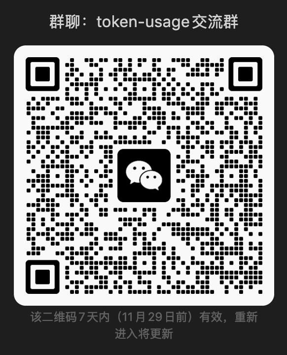

<p align="center">
  
</p>

<h1 align="center">Token Usage</h1>

<p align="center">
  <strong>더 이상 토큰을 감으로 쓰지 마세요 — <a href="https://antigravity.google">Antigravity</a>를 위한 실시간 토큰·컨텍스트·구독 ROI·로컬 보안 분석 플러그인.</strong><br />
  <sub>100% 로컬 읽기 전용 · 외부 의존성 제로 · 프라이버시 우선 · 즉시 사용 가능</sub>
</p>

<p align="center">
  <a href="./README.md">简体中文</a> ·
  <a href="./README.en.md">English</a> ·
  <a href="./README.ja.md">日本語</a> ·
  <strong>한국어</strong> ·
  <a href="./README.es.md">Español</a>
</p>

<p align="center">
  <a href="./plugin.json"></a>
  <a href="./LICENSE"></a>
  <a href="./sidecars/token_panel/package.json"></a>
  <a href="#-프라이버시-및-보안"></a>
  
</p>

<p align="center">
  
</p>

### 🎬 48초 제품 데모 영상

https://github.com/user-attachments/assets/a50520b6-e04e-488b-94e4-507da9354e38

---

## 🎯 왜 개발자들이 Token Usage를 사용할까요?

| 흔한 불편함 | Token Usage의 해결 방법 |
| :--- | :--- |
| 😵 **갑자기 컨텍스트 초과 / Compact 압축 발생** | 실시간 사용량·잔여·한도 게이지, **Compact 시점** 자동 표시 곡선, `80% / 90%` 사전 경고 |
| 💸 **구독 요금제 본전을 뽑고 있는지 궁금함** | **구독 ROI 대시보드**(`$20 Pro / $100 Ultra / $200 Ultra` 및 커스텀 요금)로 회수 배수와 캐시 절감액 실시간 계산 |
| 🐌 **한 턴이 느린데 모델 때문인지 도구 때문인지 모름** | **모델 사고 시간 vs 도구 실행 시간** 2색 분리 + 모든 도구 입출력을 펼치는 **JSON 트리 뷰어** |
| 🔐 **대화 로그에 API 키·비밀 키가 남을까 걱정** | **100% 로컬 Lite DLP**가 7종 자격 증명 스캔 — 원본은 절대 저장·표시하지 않고 마스킹 + 원클릭 턴 이동 |
| 📊 **프로젝트별 정산이나 공유용 리포트 필요** | **Top 10 워크스페이스 자동 귀속**, CSV/JSON 내보내기, **2× Retina 비식별 PNG 공유 카드** 원클릭 생성 |

---

## ⚡ 10초 초간단 설치 (추천: Agent에게 한 문장으로 끝내기)

터미널을 열 필요가 없습니다. **아래 한 문장을 Antigravity 채팅창에 그대로 붙여넣기만 하면** Agent가 클론·동기화·검증·활성화 링크 안내까지 자동으로 처리합니다:

> ```text
> https://github.com/RanFeng/token-usage Antigravity 플러그인을 ~/.gemini/config/plugins/token-usage 에 설치해 줘 (sync.sh가 있으면 실행). 설치된 파일을 검증하고 Token Usage 패널을 활성화해서 열 수 있는 링크를 알려줘.
> ```

> **🔄 업데이트도 한 문장으로 완료**:
> `token-usage 플러그인을 https://github.com/RanFeng/token-usage 최신 버전으로 업데이트하고 ~/.gemini/config/plugins/token-usage 에 동기화해 줘.`

<details>
<summary><strong>🛠️ 수동 CLI 설치를 원하시나요? 클릭해서 펼치기</strong></summary>

- **요구 사항**: Antigravity / Node.js 18+ / Python 3.8+
- **macOS / Linux**:
  ```bash
  git clone https://github.com/RanFeng/token-usage.git
  cd token-usage && ./sync.sh
  ```
- **Windows (PowerShell)**:
  ```powershell
  git clone https://github.com/RanFeng/token-usage.git "$env:USERPROFILE\.gemini\config\plugins\token-usage"
  ```
- **활성화**: Antigravity → **Customizations / Plugins**에서 **Token Usage**를 켜고 보조 사이드바(**Aux Pane**)에서 여세요.

</details>

---

## ✨ 핵심 기능 비주얼 투어

### 1. 실시간 컨텍스트 투시 & 턴별 X-Ray 분석 (Current 탭)
<p align="center">
  
</p>

실시간 컨텍스트 게이지, 누적 `input / cache_read / output`, API 환산 비용, Compact 압축점 자동 마킹, 모델 사고 vs 도구 실행 시간 분리, 검색·접기 지원 JSON 트리 뷰어를 제공합니다.

### 2. 12+ 차원 트렌드 총람 & 구독 ROI 대시보드 (Overview 탭)
<p align="center">
  
</p>

구독 ROI 배수와 월말 소비 예측, 90일 GitHub 스타일 히트맵, 14일 막대 차트, 24시간 코딩 패턴, Top 10 모델/도구, 로컬 업적 배지, 통화(`USD`/`CNY`) 및 모델별 단가 커스터마이징을 지원합니다.

### 3. 실시간 세션 상태 진단 & 100% 로컬 Lite DLP
<p align="center">
  
</p>

Compact 임박·연속 오류 루프·단일 턴 급증·낮은 캐시 적중률 4종 경고와 함께 7종 자격 증명(API Key / AWS / GitHub / Google / JWT / 개인 키 / DB URI)을 로컬에서 즉시 마스킹 탐지합니다.

### 4. 로컬 Multi-Tool 레이더 & 프로젝트별 비용 정산
<p align="center">
  
</p>

활성 워크스페이스 Top 10 자동 비용 귀속, UTF-8 BOM **CSV** / **JSON** / Markdown 내보내기(`~/Downloads` 직접 저장), Claude Code / Codex / Cursor / Gemini CLI 로컬 세션 수 레이더를 제공합니다.

### 5. 2× Retina 공유 카드 & `/token-usage` 채팅 Skill
<p align="center">
  
</p>

다크/라이트 테마 2× 고해상도 리포트 카드, 100% 비식별 세션 진단 카드(프롬프트·경로·비밀 정보 제로), 채팅 내 `/token-usage` Skill과 독립 CLI(`token_stats.py`)를 함께 사용할 수 있습니다.

---

## 📖 독립 CLI 명령어 (`token_stats.py`)

```bash
# 최근 세션 요약 (--sort: recent | tokens)
python3 ~/.gemini/config/plugins/token-usage/skills/token-usage/scripts/token_stats.py summary --limit 15 --sort recent
# 단일 세션 턴별 상세 (latest / 8자리 접두사 / 전체 UUID)
python3 ~/.gemini/config/plugins/token-usage/skills/token-usage/scripts/token_stats.py session latest
# 전체 및 모델별 누적 합계
python3 ~/.gemini/config/plugins/token-usage/skills/token-usage/scripts/token_stats.py models
```

---

## 🔒 프라이버시 및 보안

- **100% 로컬 & 읽기 전용**: `~/.gemini/antigravity/brain/` 로컬 로그만 읽으며 외부 전송이나 바이너리 수정이 전혀 없습니다.
- **외부 의존성 제로**: 순수 Node.js ESM, 바닐라 HTML/CSS/JS, Python 3 표준 라이브러리만 사용합니다.
- **텔레메트리 제로**: 선택적 업데이트 확인 시에만 GitHub Releases 공개 API를 조회합니다(7일 로컬 캐시).

---

## 🌟 커뮤니티 및 링크

도움이 되셨다면 **Star ⭐** 로 응원해 주세요!

- 💬 **질문·ROI 카드 공유·로드맵 투표**: [GitHub Discussions](https://github.com/RanFeng/token-usage/discussions)
- 🐛 **버그 제보 및 기능 제안**: [GitHub Issues](https://github.com/RanFeng/token-usage/issues)
- 📖 **문서**: [`.ai_map.md`](./.ai_map.md) · [CHANGELOG](./CHANGELOG.md) · [CONTRIBUTING](./CONTRIBUTING.md) · [MIT License](./LICENSE)

### 💬 WeChat 교류방 & 제작자 연락처

아래 QR 코드를 스캔해 **token-usage 교류방**에 참여하세요(QR 코드가 만료된 경우 제작자 WeChat으로 연락해 주세요):

- **제작자 WeChat**: `x64Crack` (**친구 추가 시 반드시 `token-usage`를 메모로 남겨 주세요**)

<p align="center">
  
</p>
