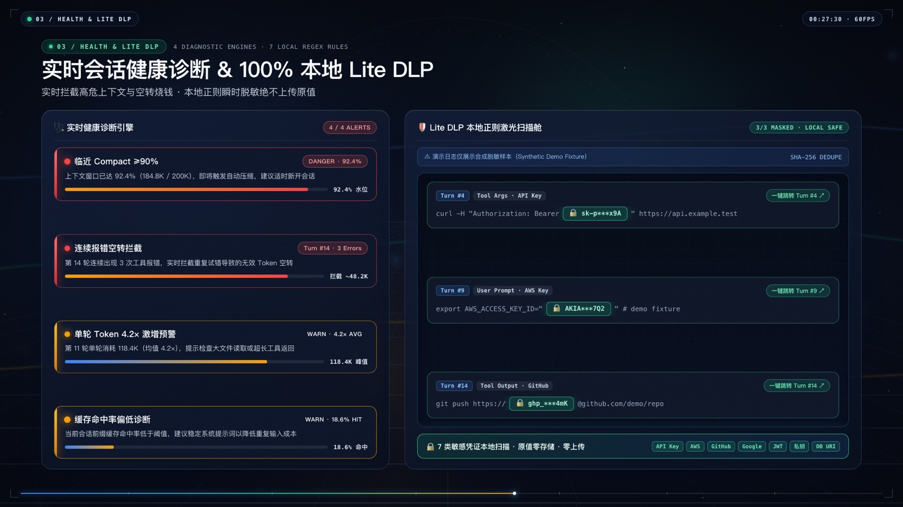

<p align="center">
  
</p>

<h1 align="center">Token Usage</h1>

<p align="center">
  <strong>别再“盲飞”烧 Token —— 为 <a href="https://antigravity.google">Antigravity</a> 打造的实时 Token、上下文水位、订阅回本 ROI 与本地安全透视插件。</strong><br />
  <sub>100% 本地只读 · 零外部依赖 · 隐私优先 · 开箱即用</sub>
</p>

<p align="center">
  <strong>简体中文</strong> ·
  <a href="./README.en.md">English</a> ·
  <a href="./README.ja.md">日本語</a> ·
  <a href="./README.ko.md">한국어</a> ·
  <a href="./README.es.md">Español</a>
</p>

<p align="center">
  <a href="./plugin.json"></a>
  <a href="./LICENSE"></a>
  <a href="./sidecars/token_panel/package.json"></a>
  <a href="#-隐私与安全承诺"></a>
  
</p>

<p align="center">
  
</p>

---

## 🎯 为什么开发者都在用 Token Usage？

用 AI Coding 写代码很爽，但你是不是也经常遇到这些困惑？

| 常见痛点 | Token Usage 的解法 |
| :--- | :--- |
| 😵 **上下文突然爆了 / 被 Compact 失忆** | 实时监控上下文水位（已用 / 剩余 / 上限），折线图自动标红 **Compact 压缩点**，临近 `80% / 90%` 主动预警 |
| 💸 **不知道订阅套餐到底回本没** | 内置 **订阅回本 ROI 仪表盘**（支持 `$20 Pro / $100 Ultra / $200 Ultra` 与自定义月/周费），实时算出回本倍数与缓存“白嫖”金额 |
| 🐌 **一轮卡半天，不知道慢在哪** | 逐轮拆解 **模型思考耗时 vs 工具执行耗时**，内置 **JSON 树状查看器** 一键透视每次工具入参与返回 |
| 🔐 **担心日志里不小心泄漏 Key / 私钥** | **100% 本地 Lite DLP** 扫描 7 类高危凭证，原值零存储零展示，仅显示打码片段并支持一键跳转对应轮次 |
| 📊 **想按项目对账或晒一张极客战报** | 自动归因 **Top 10 活跃工作区**，一键导出 CSV/JSON 账单，还可生成 **2× 视网膜级脱敏 PNG 战报卡** |

---

## ⚡ 10 秒极速安装（强烈推荐：让 Agent 一句话搞定）

无需打开终端、无需手动敲命令。**直接复制下面这句话粘贴到 Antigravity 对话框**，让 Agent 自动帮你克隆、同步、校验并给出开启入口：

> ```text
> 请帮我把 https://github.com/RanFeng/token-usage 这个 Antigravity 插件安装到 ~/.gemini/config/plugins/token-usage（优先运行仓库自带的 sync.sh 同步），检查安装文件是否完整，并给我启用和打开 Token Usage 面板的入口。
> ```

**Agent 会自动完成：**
1. 拉取 `https://github.com/RanFeng/token-usage` 最新代码。
2. 将核心插件文件同步至 `~/.gemini/config/plugins/token-usage`。
3. 校验完整性，直接返回 **Customizations / Plugins** 开关链接，点击即可实时生效（无需重启）。

> **🔄 后续升级同样只需一句话**：
> `请帮我把 token-usage 插件从 https://github.com/RanFeng/token-usage 更新到最新版本，并重新同步到 ~/.gemini/config/plugins/token-usage。`

<details>
<summary><strong>🛠️ 偏好手动命令行安装？点击展开（macOS / Linux / Windows）</strong></summary>

#### 环境要求
- 已安装 **Antigravity**
- **Node.js 18+**（运行零依赖 Sidecar 实时面板）
- **Python 3.8+**（运行对话 Skill 与 CLI 脚本）

#### macOS / Linux（推荐用 `sync.sh`）
```bash
git clone https://github.com/RanFeng/token-usage.git
cd token-usage
./sync.sh
```
或直接克隆到插件目录：
```bash
git clone https://github.com/RanFeng/token-usage.git ~/.gemini/config/plugins/token-usage
```

#### Windows (PowerShell)
```powershell
git clone https://github.com/RanFeng/token-usage.git "$env:USERPROFILE\.gemini\config\plugins\token-usage"
```

#### 开启面板
打开 **Antigravity** → **Customizations / Plugins** → 启用 **Token Usage** → 在右侧辅助栏（**Aux Pane**）打开 **Token Usage**。

</details>

---

## ✨ 核心功能全景展示

### 1. 实时上下文透视与逐轮 X 光拆解（Current 面板）

<p align="center">
  
</p>

- **动态上下文水位**：一眼看清已用 / 剩余 / 上限比例，同步统计累计 `input`、`cache_read`、`output` Token、等效 API 费用与缓存省钱额。
- **上下文增长曲线 & Compact 标红**：完整记录每轮膨胀轨迹，自动高亮 **Compact 压缩骤降点**。
- **双色耗时拆解 & JSON 树状查看器**：区分**模型思考耗时 vs 工具执行耗时**，支持关键词搜索、快捷筛选（全部 / 高消耗 / 含错误 / 含媒体），点击即可在可折叠 JSON 树中查看工具参数与输出。

---

### 2. 12+ 维趋势总览 & 订阅回本 ROI 仪表盘（Overview 面板）

<p align="center">
  
</p>

- **订阅回本 ROI 一目了然**：支持 `$20 Pro / $100 Ultra / $200 Ultra` 或自定义月/周订阅费与重置日，实时追踪回本倍数、月末消耗预测与缓存“白嫖”折算。
- **全机编码画像**：90 天 GitHub 风格活跃热力图、近 14 天每日柱状图、24 小时编程作息画像（含工作日/周末对比）、全机模型与工具 Top 10、上下文健康评分、本地成就徽章墙与名人堂。
- **双语 & 多币种 & 自定义单价**：一键切换 `EN / 中` 与 `USD ($) / CNY (¥)`，支持自定义汇率与 `Pro / Flash / Claude / GPT` 各模型家族百万 Token 单价。

---

### 3. 实时会话健康诊断 & 100% 本地 Lite DLP 安全扫描

<p align="center">
  
</p>

- **4 类实时健康预警**：自动拦截 **临近 Compact（`≥80% / ≥90%`）**、**连续报错空转**、**单轮 Token 异常激增**、**缓存命中率偏低**，帮你及时止损。
- **7 类敏感凭证本地扫描**：纯本地正则检测 `API Key`、`AWS Key`、`GitHub Token`、`Google Key`、`JWT`、私钥、数据库连接串。**绝不存储或展示原值**，仅呈现打码片段并支持一键跳转对应轮次排查。

---

### 4. 本地多工具雷达 & 项目成本归因账单

<p align="center">
  
</p>

- **项目成本归因 Top 10**：根据工具操作路径自动识别你的活跃工作区，精准核算每个项目的 Token 消耗、费用与缓存省钱额。
- **一键导出对账账单**：按「本月 / 近 30 天 / 全部」一键导出 UTF-8 BOM **CSV**（Excel 零乱码）、**JSON** 账本，以及当前会话 Markdown / 脱敏诊断报告，直接写入 `~/Downloads`。
- **360° 本地多工具雷达**：轻量只读探测本机 **Claude Code**、**Codex**、**Cursor**、**Gemini CLI** 历史会话数（仅计数，不读取第三方对话内容）。

---

### 5. 2× 视网膜级战报分享 & `/token-usage` 对话内 Skill

<p align="center">
  
</p>

- **高清 2× Canvas 分享图**：支持**趋势总览战报卡**（深浅双主题 + 模块自由勾选）与 **100% 脱敏单会话诊断卡**（绝不包含提问内容、路径、项目名或密钥），一键复制图片或保存到本地。
- **对话内 `/token-usage` Skill**：无需切面板，在 Antigravity 对话框直接提问即可输出结构化统计表。

---

## 📖 三种使用方式一览

| 使用方式 | 适用场景 | 怎么用 |
| :--- | :--- | :--- |
| **1. 侧边栏实时面板（Aux Pane）** | 日常边写代码边看水位、ROI、热力图、DLP 与导出账单 | 启用插件后，在 Antigravity 右侧辅助栏打开 **Token Usage** |
| **2. 对话内 Skill** | 在聊天中随手盘点消耗与模型分布 | 输入 `/token-usage` 或直接问：*“统计最近 10 个会话的 Token 消耗”* / *“查看当前会话逐轮明细”* / *“按模型统计总消耗”* |
| **3. 独立 CLI 脚本** | 终端自动化统计或脚本集成（纯 Python 3 标准库） | 见下方命令 |

```bash
# 1. 查看近期会话汇总（--sort: recent | tokens，--limit 默认 15）
python3 ~/.gemini/config/plugins/token-usage/skills/token-usage/scripts/token_stats.py summary --limit 15 --sort recent

# 2. 查看单会话逐轮明细（支持传入 latest、8 位 ID 前缀或完整 UUID）
python3 ~/.gemini/config/plugins/token-usage/skills/token-usage/scripts/token_stats.py session latest

# 3. 查看全机及各模型 Token 总消耗
python3 ~/.gemini/config/plugins/token-usage/skills/token-usage/scripts/token_stats.py models
```

> **口径说明**：`input` = 未命中缓存输入 Token，`cache_read` = 提示词缓存命中 Token，`output` = 模型输出 Token（默认 `total = input + output`）。

---

## 🔒 隐私与安全承诺

- **100% 本地只读**：直接读取 `~/.gemini/antigravity/brain/<conversation-id>/.system_generated/logs/transcript.jsonl`，不修改官方程序、不上传任何对话或代码。
- **零外部依赖**：纯原生 Node.js (ESM) + 原生 HTML/CSS/Canvas/JS + Python 3 标准库，无任何第三方 npm/pip 包。
- **分享级脱敏**：单会话诊断图自动剥离所有提示词、文件路径、项目名与凭证。
- **网络零遥测**：零埋点上报；仅在检查版本更新时请求 GitHub Releases 公开接口（本地缓存 7 天）。

---

## ❓ 常见问题（FAQ）

<details>
<summary><strong>安装完成后没看到 Token Usage 侧边栏面板？</strong></summary>

1. 确认 `~/.gemini/config/plugins/token-usage/plugin.json` 存在。
2. 打开 Antigravity → **Customizations / Plugins** 确认已开启 **Token Usage**。
3. 确认系统 `PATH` 中有 `node`（Node.js 18+）以便 Sidecar 本地服务启动。
</details>

<details>
<summary><strong>为什么估算费用和官方账单不完全一致？</strong></summary>

面板费用按各模型家族默认百万 Token 单价做 API 等效估算。你可以随时在右上角 **设置** 中自定义单价、币种汇率（`USD`/`CNY`）与你的实际订阅费用/周期。
</details>

<details>
<summary><strong>如何卸载？</strong></summary>

对 Antigravity 说一句 *“帮我卸载 token-usage 插件”*，或在 **Customizations / Plugins** 中禁用/卸载，或直接删除 `~/.gemini/config/plugins/token-usage`。
</details>

---

## 🌟 参与共建与交流

如果 **Token Usage** 帮你看清了 Token 消耗或避开了 Compact 踩坑，欢迎点一个 **Star ⭐** 支持！

- 💬 **功能许愿、晒 ROI 战报与路线图投票**：[GitHub Discussions](https://github.com/RanFeng/token-usage/discussions)
- 🐛 **Bug 反馈与功能建议**：[GitHub Issues](https://github.com/RanFeng/token-usage/issues)
- 📖 **项目架构导航**：[`.ai_map.md`](./.ai_map.md) · [更新日志 (`CHANGELOG.md`)](./CHANGELOG.md) · [贡献指南 (`CONTRIBUTING.md`)](./CONTRIBUTING.md)
- 📄 **开源协议**：[MIT License](./LICENSE)
