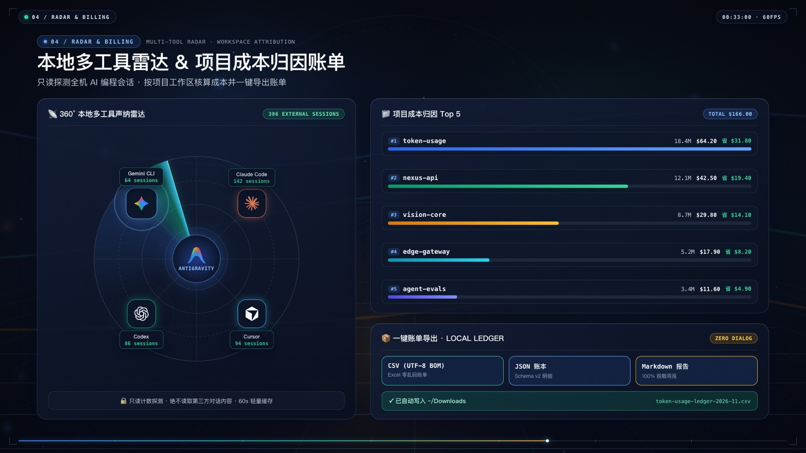

# Token Usage 多平台图文推广推文合集

> **素材说明**：
> - 所有推文均已嵌入项目内高清配图（`../assets/screenshots/*.jpg`），本地预览可直接渲染图文效果。
> - 如发布到公众号、知乎、掘金、V2EX 等外部平台，可直接上传 `assets/screenshots/` 下的对应图片，或使用 `promo/token-usage-promo.mp4`（48 秒 1080p60 宣传片）作为视频封面/首条推文。
> - GitHub 仓库：`https://github.com/RanFeng/token-usage`

---

## 一、深度图文长文（公众号 / 掘金 / 知乎 / 少数派）

### 备选标题
1. **别再“盲飞”烧 Token 了！我给 Antigravity 做了个开源透视面板：实时看上下文水位、算订阅回本 ROI、顺手防 Key 泄漏**
2. **\$20 的 AI 编程订阅到底值不值？装上这个零依赖开源插件后，我发现本月已经 7.4× 回本，还白嫖了 32 杯咖啡**
3. **写代码写到一半 AI 突然“失忆”？用这款 100% 本地开源插件，给你的 Antigravity 装上“仪表盘 + 黑匣子”**

---

### 正文内容


用 Antigravity 写代码有多爽，相信大家都有体会——一个需求丢进去，Agent 自己读代码、改文件、跑命令、修 Bug，效率直接拉满。

但用久了，你是不是也经常遇到这几个让人抓狂的瞬间？

- 😵 **突然“失忆”**：聊得正起劲，上下文突然撞线触发 **Compact 压缩**，AI 瞬间忘了前面定好的架构约束，开始胡改一通；
- 💸 **账单黑盒**：每月交着 \$20 Pro 甚至 \$100 / \$200 Ultra 订阅费，到底是用回本了，还是在给官方做慈善？完全没数；
- 🐌 **盲等卡顿**：一轮对话转圈半分钟，到底是模型在深度思考，还是某个工具调用卡死了？
- 🔐 **隐私焦虑**：调试接口时顺手贴了段带 API Key 或数据库连接串的日志，回头根本不记得留在哪一轮里了。

为了彻底告别“盲飞”烧 Token，开源项目 **Token Usage（v1.1.0）** 来了——一个专为 Antigravity 打造的**实时 Token、上下文水位、订阅回本 ROI 与本地安全透视插件**。

它 **100% 本地只读、零外部依赖（无任何 npm/pip 第三方包）、开源免费（MIT 协议）**，装上之后，Antigravity 右侧辅助栏立刻多出一块堪比赛博驾驶舱的实时遥测面板。

---

#### 1. 实时上下文透视：告别突然 Compact“失忆”


打开 **Current（当前会话）** 面板，你再也不用靠猜来判断上下文快满没满：

- **动态上下文水位**：一眼看清已用 / 剩余 / 上限比例，同步汇总 `input`、`cache_read`、`output` Token、等效 API 费用以及提示词缓存帮你省下的真金白银。
- **上下文增长曲线 & Compact 标红**：完整绘制每一轮的上下文膨胀轨迹，自动在曲线上标红 **Compact 压缩骤降点**。
- **逐轮 X 光拆解 & JSON 树透视**：双色进度条直接拆解**模型思考耗时 vs 工具执行耗时**；支持关键词搜索与快捷筛选（高消耗 / 含错误 / 含媒体），点开就能在可折叠的 **JSON 树状查看器** 里检查每次工具调用的入参与返回。

---

#### 2. 12+ 维全景看板：算清你的订阅到底回没回本


很多人最好奇的问题是：**“我这个月到底烧了多少等效 API 费用？”**

切到 **Overview（趋势总览）**，直接给你一份爽感拉满的量化仪表盘：

- **订阅回本 ROI 仪表盘**：内置 `\$20 Pro / \$100 Ultra / \$200 Ultra` 预设，也支持自定义月/周费与重置日。像图中这样，\$20 月费干出 \$147.35 等效 API 价值，**737% ROI（7.4× 回本）**，缓存还帮你“白嫖”了 **32 杯咖啡**，顺带预测月末总消耗。
- **全机编码画像**：自带 **90 天 GitHub 风格活跃热力图**、**24 小时编程作息分布**（你是清晨派还是深夜架构师？）、**主力模型 Top 10**、工具调用排行、上下文健康评分与本地成就徽章墙。
- **双语 & 多币种 & 自定义单价**：一键切换 `中 / EN` 与 `USD ($) / CNY (¥)`，模型单价和汇率都能按你的真实口径自定义。

---

#### 3. 实时会话健康诊断 & 100% 本地 Lite DLP 安全护盾


Token Usage 不只是“事后算账”，还能在写代码的过程中**实时止损 + 守住安全底线**：

- **4 类实时健康预警**：
  - 临近 Compact（`≥80% / ≥90%`）主动提醒，让你在失忆前优雅开新会话；
  - 连续报错空转拦截，防止 Agent 死循环狂烧 Token；
  - 单轮 Token 异常激增预警（比如不小心读了超大日志或构建产物）；
  - 缓存命中率偏低诊断。
- **100% 本地 Lite DLP 扫描**：纯本地正则检测 `API Key`、`AWS Key`、`GitHub Token`、`Google Key`、`JWT`、私钥、数据库连接串共 **7 类敏感凭证**。**绝不存储、绝不上传、绝不展示原值**，只显示打码片段，点一下直接跳转到对应的对话轮次方便你排查清理。

---

#### 4. 项目成本归因账单 & 360° 本地多工具雷达



如果你同时维护多个项目，或者需要给团队/客户对账，这个功能会让你爱不释手：

- **项目成本归因 Top 10**：自动根据工具操作路径识别你的活跃工作区，清清楚楚列出每个项目烧了多少 Token、等效多少钱、缓存省了多少。
- **一键导出本地账单**：按「本月 / 近 30 天 / 全部」一键导出 **UTF-8 BOM CSV**（Excel 打开零乱码）、**JSON 账本** 或 **脱敏 Markdown 报告**，直接写入 `~/Downloads`。
- **360° 本地多工具雷达**：轻量只读探测本机 **Claude Code / Codex / Cursor / Gemini CLI** 的历史会话数（仅计数，绝不读取第三方对话内容），一眼看清自己的 AI 编程工具版图。

---

#### 5. 2× 视网膜级战报分享 & `/token-usage` 对话内 Skill


- **一键生成 2× 高清分享卡**：想在朋友圈、X 或技术群晒晒战绩？内置 Canvas 2× 视网膜级分享图生成器，支持**趋势总览战报卡**（深浅双主题、模块自由勾选）和 **100% 脱敏单会话诊断卡**（自动剥离所有提示词、文件路径、项目名与密钥），一键复制到剪贴板或保存 PNG。
- **对话内 `/token-usage` Skill**：懒得看侧边栏？直接在 Antigravity 对话框里输入 `/token-usage`，或者问一句“统计最近 10 个会话的 Token 消耗”，Agent 直接在对话里给你拉出结构化报表。

---

#### ⚡ 10 秒极速安装：不用敲命令，一句话交给 Agent

安装方式非常“Antigravity”——**不需要开终端，直接复制下面这句话粘贴到 Antigravity 对话框即可**：

```text
请帮我把 https://github.com/RanFeng/token-usage 这个 Antigravity 插件安装到 ~/.gemini/config/plugins/token-usage（优先运行仓库自带的 sync.sh 同步），检查安装文件是否完整，并给我启用和打开 Token Usage 面板的入口。
```

Agent 会自动拉取代码、同步插件并给出启用入口，点击开启立即生效，无需重启。

#### 🔒 隐私与安全底线
- **100% 本地只读**：只读取本机 `transcript.jsonl`，不修改官方程序、不上传任何对话或代码。
- **零外部依赖**：纯原生 Node.js (ESM) + HTML/CSS/Canvas + Python 3 标准库。
- **MIT 开源**：代码完全透明，欢迎去 GitHub 审阅源码。

👉 **项目地址**：https://github.com/RanFeng/token-usage  
如果它帮你避开了 Compact 踩坑或算清了订阅回本账，欢迎点个 **Star ⭐** 支持开源！

---

## 二、小红书 / 即刻 图文种草体

### 标题
**把 Antigravity 玩出赛博驾驶舱质感！\$20 订阅干出 7.4 倍回本是什么体验？**

### 配图顺序（建议 6 张轮播）
1. **封面图**：`../assets/screenshots/hero-banner.jpg`（文字贴纸：Antigravity 必装开源神插件）
2. **图 2**：`../assets/screenshots/trend-overview.jpg`（ROI 737% + 白嫖 32 杯咖啡 + 90 天热力图）
3. **图 3**：`../assets/screenshots/live-telemetry.jpg`（实时上下文水位 + Compact 红点预警）
4. **图 4**：`../assets/screenshots/health-dlp.jpg`（防空转烧钱 + 本地扫描 API Key 泄漏）
5. **图 5**：`../assets/screenshots/radar-billing.jpg`（按项目算账 + 一键导 CSV + 多工具雷达）
6. **图 6**：`../assets/screenshots/share-skill.jpg`（2× 高清脱敏战报卡 + 对话内 `/token-usage`）

### 正文文案

用 AI 写代码最怕两件事：
1️⃣ 聊到一半上下文突然爆了，AI 一键 Compact 直接“失忆”🤯
2️⃣ 每月交着 \$20 / \$200 订阅费，根本不知道自己到底回没回本💸

直到给 Antigravity 装上这个开源插件 **Token Usage**，整个开发体验直接从“盲飞”升级成“透明驾驶舱”🚀

✨ **用完最上头的 5 个功能：**
📊 **订阅回本 ROI 仪表盘**：直接算清等效 API 价值、回本倍数，连提示词缓存帮你“白嫖了多少杯咖啡”都标得明明白白，顺手还有 90 天活跃热力图 & 24h 编码作息画像！
📈 **实时上下文水位 & Compact 标红**：快到 80%/90% 提前预警，还能拆解每轮「模型思考 vs 工具执行」耗时，卡在哪一眼看穿。
🛡️ **100% 本地 Lite DLP 安全扫描**：自动排查日志里有没有不小心漏掉的 API Key / AWS / GitHub Token / 数据库连接串，原值绝不存储不上传，一键跳回对应轮次。
🗂️ **项目成本归因 & 一键导账单**：自动按工作区算清每个项目烧了多少，一键导出 Excel 零乱码 CSV，还附带本机 Claude Code / Cursor / Codex / Gemini CLI 会话雷达。
🎨 **2× 视网膜级战报分享卡**：深浅双主题 + 100% 脱敏，发群发圈装 X 必备！

🔒 **最放心的一点**：
100% 本地只读 · 零第三方依赖 · MIT 开源免费，绝不上传任何代码和对话。

⚡ **10 秒安装（连终端都不用开）**：
直接把下面这句话发给 Antigravity 就自动装好了👇
> 请帮我把 https://github.com/RanFeng/token-usage 这个 Antigravity 插件安装到 ~/.gemini/config/plugins/token-usage（优先运行仓库自带的 sync.sh 同步），检查安装文件是否完整，并给我启用和打开 Token Usage 面板的入口。

GitHub 搜索：`RanFeng/token-usage`（开源免费，顺手点个 Star 不迷路⭐）

`#Antigravity #AICoding #程序员 #独立开发 #开源项目 #效率工具 #AI编程 #VibeCoding`

---

## 三、X (Twitter) 爆款 Thread（中英双语版）

### 中文 Thread（7 条连发）

**1/7（配视频 `promo/token-usage-promo.mp4` 或 `../assets/screenshots/hero-banner.jpg`）**
别再“盲飞”烧 Token 了！🚀

我为 Antigravity 开源了一款 100% 本地、零依赖的透视插件 —— **Token Usage v1.1.0**。

在侧边栏直接拥有：
• 实时上下文水位 & Compact 压缩预警
• 订阅回本 ROI 仪表盘
• 本地 Lite DLP 敏感凭证扫描
• 项目成本归因 & 2× 脱敏战报卡

一条 Thread 带你看全貌 🧵👇

**2/7（配图 `../assets/screenshots/live-telemetry.jpg`）**
1️⃣ 实时上下文透视 & 逐轮 X 光拆解

再也不用猜什么时候会触发 Compact 失忆。
实时追踪上下文余量、标红 Compact 压缩点，双色条拆解「模型思考 vs 工具执行」耗时，内置 JSON 树直接钻取每次工具入参与返回。

**3/7（配图 `../assets/screenshots/trend-overview.jpg`）**
2️⃣ 12+ 维全景看板 & 订阅回本 ROI

你的 \$20 Pro 或 \$200 Ultra 到底回本没？
实时算出等效 API 价值、回本倍数（比如 7.4×）与缓存白嫖金额，外加 90 天 GitHub 风格活跃热力图、24h 编程作息画像、主力模型排行。支持中英双语 & USD/CNY 自定义单价。

**4/7（配图 `../assets/screenshots/health-dlp.jpg`）**
3️⃣ 实时健康诊断 & 100% 本地 Lite DLP

• 4 类实时预警：临近 Compact（≥80%/90%）、连续报错空转、单轮 Token 激增、低缓存命中
• 7 类高危凭证本地正则扫描（API Key / AWS / GitHub / JWT / 私钥 / DB URI），原值零存储零上传，一键跳转对应轮次。

**5/7（配图 `../assets/screenshots/radar-billing.jpg`）**
4️⃣ 项目成本归因 & 360° 本地多工具雷达

自动按工作区核算 Top 10 项目成本，一键导出 Excel 零乱码 CSV / JSON / 脱敏 Markdown 账单到 `~/Downloads`。
还能轻量只读探测本机 Claude Code / Codex / Cursor / Gemini CLI 会话数（仅计数，不读内容）。

**6/7（配图 `../assets/screenshots/share-skill.jpg`）**
5️⃣ 2× 视网膜级分享卡 & `/token-usage` 对话 Skill

深浅双主题一键出图，单会话诊断卡 100% 脱敏（剥离提示词/路径/项目名/密钥）。
懒得切面板？直接在对话框敲 `/token-usage` 就能拉出结构化消耗表。

**7/7（纯文 + 仓库卡片）**
100% 本地只读 · 零 npm/pip 依赖 · MIT 开源。

不需要敲命令，直接把下面这句话发给 Antigravity，10 秒自动装好：
> 请帮我把 https://github.com/RanFeng/token-usage 这个 Antigravity 插件安装到 ~/.gemini/config/plugins/token-usage（优先运行仓库自带的 sync.sh 同步），并给我开启入口。

GitHub（求个 ⭐）：https://github.com/RanFeng/token-usage

---

### English Thread (For Global Launch / X / Reddit)

**1/6 (Attach `promo/token-usage-promo.mp4` or `../assets/screenshots/hero-banner.jpg`)**
Stop flying blind with your AI coding tokens. 🚀

Meet **Token Usage v1.1.0** — an open-source, 100% local, zero-dependency telemetry cockpit for **Antigravity**.

• Live context gauge & Compact drop alerts
• Subscription ROI dashboard
• Local Lite DLP secret scanner
• Project billing & 2× share cards

Quick tour 🧵👇

**2/6 (Attach `../assets/screenshots/live-telemetry.jpg`)**
Live Context Telemetry & Per-Turn X-Ray:
Track exact `input` / `cache_read` / `output` tokens, spot Compact drops on the curve before your agent loses memory, split model thinking vs. tool execution latency, and inspect any tool call in a searchable JSON tree.

**3/6 (Attach `../assets/screenshots/trend-overview.jpg`)**
12+ Dimension Overview & Subscription ROI:
Is your \$20 Pro or \$200 Ultra plan paying off? See real-time ROI multiplier, cache savings, 90-day GitHub-style activity heatmap, 24h coding persona, and top models. Full EN/ZH + USD/CNY + custom pricing.

**4/6 (Attach `../assets/screenshots/health-dlp.jpg`)**
Real-Time Diagnostics & 100% Local Lite DLP:
Catch ≥80%/90% context limits, error loops, and token spikes early.
Local regex scans for 7 secret types (API Keys, AWS, GitHub, JWT, Private Keys, DB URIs) — zero raw storage, masked preview only, 1-click jump to the exact turn.

**5/6 (Attach `../assets/screenshots/radar-billing.jpg` & `../assets/screenshots/share-skill.jpg`)**
Workspace Cost Attribution + Multi-Tool Radar + 2× Share Cards:
Auto-attribute costs across Top 10 workspaces, export CSV/JSON/Markdown ledgers straight to `~/Downloads`, peek at local session counts for Claude Code / Cursor / Codex / Gemini CLI (read-only count), and generate 100% sanitized 2× PNG share cards or use `/token-usage` right in chat.

**6/6**
100% local read-only. Zero npm/pip dependencies. MIT licensed.

Install in 10 seconds by pasting one sentence into Antigravity — or clone from GitHub:
https://github.com/RanFeng/token-usage

If it saves you from a single surprise Compact, a ⭐ would mean the world!

---

## 四、V2EX / Linux.do 极客硬核自荐体

### 标题
`[开源] 给 Antigravity 写了个零依赖本地 Token 透视插件：上下文水位、Compact 预警、订阅 ROI 与本地 Lite DLP`

### 正文

重度用 Antigravity 写代码一段时间后，有几个痛点一直很膈应：
1. 上下文膨胀过程是黑盒，经常聊着聊着突然触发 Compact，前面铺垫的上下文直接丢一半；
2. 订阅费（\$20 / \$100 / \$200）到底用了多少等效 API 价值、提示词缓存省了多少，完全没概念；
3. 某轮特别慢时，分不清是模型思考久还是工具执行卡住了；
4. 怕调试日志里不小心留下 Key / Token，想有个纯本地的自检手段。

于是写了个开源插件 **Token Usage（v1.1.0，MIT）**，直接跑在 Antigravity 的 Aux Pane（右侧辅助栏）里，顺带配了一个对话内 `/token-usage` Skill 和独立 Python CLI。

#### 技术实现（极简 & 隐私优先）
- **100% 本地只读**：直接解析 `~/.gemini/antigravity/brain/<id>/.system_generated/logs/transcript.jsonl`，不修改官方程序，不联网上报任何遥测数据。
- **零外部依赖**：Sidecar 后端用纯原生 Node.js (ESM)，前端原生 HTML/CSS/Canvas/JS，CLI 用 Python 3 标准库，**0 个 npm/pip 依赖**。
- **性能**：全机会话扫描带 `mtime/size` 缓存，多工具雷达（仅统计本机 Claude Code / Codex / Cursor / Gemini CLI 会话数，不读内容）带 60s 内存缓存。

#### 核心界面一览


核心功能速览：
- **Current 面板**：实时上下文水位、Compact 压缩点标红曲线、模型思考 vs 工具耗时双色拆解、可搜索 JSON 树查看器。
- **Overview 面板**：自定义月/周订阅周期的 ROI 回本计算、缓存省钱折算、90 天热力图、24h 作息画像、Top 10 项目工作区成本归因、多工具雷达。
- **健康诊断 + Lite DLP**：4 类异常预警（≥80%/90% 水位、连续报错空转、单轮激增、低缓存命中）+ 7 类敏感凭证纯本地脱敏扫描（原值零存储零展示，支持一键跳回对应 Turn）。
- **导出 & 分享**：一键直写 `~/Downloads`（UTF-8 BOM CSV / JSON / 脱敏 Markdown），以及 2× Canvas 脱敏战报图。

#### 安装方式
最省事的方法是直接把下面这句话丢给 Antigravity 让它自己装：
```text
请帮我把 https://github.com/RanFeng/token-usage 这个 Antigravity 插件安装到 ~/.gemini/config/plugins/token-usage（优先运行仓库自带的 sync.sh 同步），检查安装文件是否完整，并给我启用和打开 Token Usage 面板的入口。
```
也支持常规 `git clone` + `./sync.sh` 手动安装（macOS / Linux / Windows 均可）。

GitHub：https://github.com/RanFeng/token-usage  
欢迎各位佬试用、拍砖、提 Issue / PR，觉得有用的话顺手点个 Star 感谢！

---

## 五、微信群 / 朋友圈 快捷短文案（3 个版本）

### 版本 A：晒回本爽感版（配图 `../assets/screenshots/trend-overview.jpg`）
> 给 Antigravity 装了个开源 Token 透视插件，算完账直接爽了：\$20 的订阅这个月干出 \$147 等效 API 价值，7.4 倍回本，光缓存命中就白嫖了 32 杯咖啡 ☕️  
> 100% 本地零依赖，不用敲命令，一句话发给 Agent 10 秒装好👉 https://github.com/RanFeng/token-usage

### 版本 B：痛点避坑版（配图 `../assets/screenshots/live-telemetry.jpg`）
> 用 Antigravity 写代码最怕聊到一半突然 Compact 失忆… 开源了这个侧边栏透视面板 **Token Usage**：实时看上下文水位、提前预警压缩、拆解每轮耗时，还能本地扫描有没有不小心泄漏 API Key。纯本地只读不上传，MIT 开源自取👉 https://github.com/RanFeng/token-usage

### 版本 C：极简开源求 Star 版（配图 `../assets/screenshots/hero-banner.jpg`）
> 开源了一个 Antigravity 全景 Token 透视插件 **Token Usage v1.1.0**：实时上下文水位、订阅回本 ROI、本地 Lite DLP 防泄密、项目成本归因、2× 脱敏战报卡，纯原生零依赖、100% 本地只读。欢迎体验 & 点个 ⭐ 支持：https://github.com/RanFeng/token-usage
